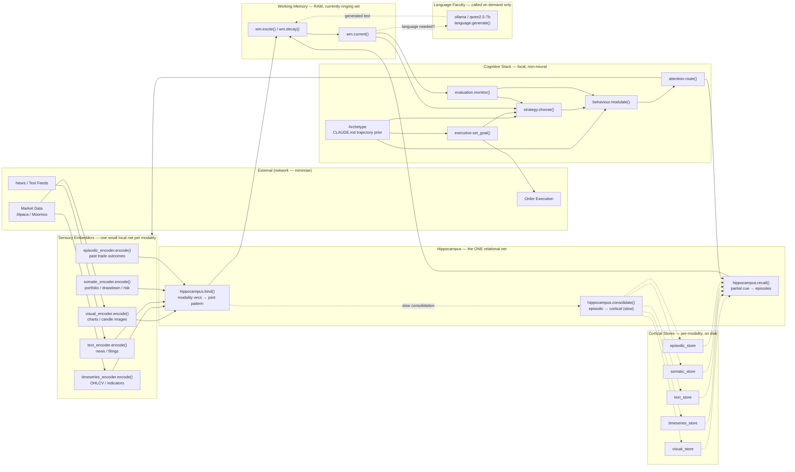

# Catalyst Conceptual Topology

## Py-function-level view — multi-modal embedders, single hippocampus, Ollama as peripheral organ

*Version 1 — Working design*

---

## The Design Bet

Instead of one large model doing everything, Catalyst uses:

- **Many small specialised embedders** — one per sensory modality. Each is a pretrained or lightly-trained small local network. Each is cheap.
- **One small hippocampus** — a single relational net whose job is to *bind* whatever the modality embedders currently produce into a joint pattern, and to *recall* joint patterns from partial cues.
- **Non-neural cognitive stack** — the Executive, Strategy, Behaviour, Attention, Evaluation layers are Python logic + learned parameters, not neural networks. Cheap. Deterministic where they should be.
- **Ollama as language faculty** — called *on demand only*, when linguistic output is needed. **Not the brain.** A peripheral organ that produces speech and reads text; nothing more.
- **Minimal network** — external calls only for market data, news, and order execution. Everything cognitive stays on the box.

This is the opposite of "LLM-as-brain." The LLM is a mouth and an ear. The brain is the resonance dynamics across the embedders, the binder, and the cognitive stack.

---

## The Diagram

---

## Function-level notes

### Sensory Embedders — one per modality

Each is a small, self-contained encoder. Pretrained off-the-shelf where possible; fine-tuned only when needed. Each fits comfortably on the RTX 4050.

| Function | Input | Output | Suggested backing |
|---|---|---|---|
| `visual_encoder.encode(img)` | chart image / candle screenshot | vec | small CLIP-family vision model |
| `timeseries_encoder.encode(ohlcv)` | numeric OHLCV window + indicators | vec | small 1D-CNN or transformer, trainable |
| `text_encoder.encode(text)` | news article / filing / commentary | vec | small sentence-transformer |
| `somatic_encoder.encode(state)` | portfolio, drawdown, exposure, capital-at-risk | vec | tiny MLP over normalised state |
| `episodic_encoder.encode(event)` | past trade record (context + outcome) | vec | small transformer on structured event |

**Design rule:** each encoder outputs to a *common dimensionality* (or a known projection to a common space) so the hippocampus can bind them. Getting this dimensionality right is a load-bearing choice — probably 256 or 512 to start.

### Hippocampus — the one relational net

The only place where cross-modal binding happens. This is where the *simultaneity index* lives.

- `hippocampus.bind(modality_vecs: dict) -> joint_pattern`
  Takes whatever modality vectors are currently active, produces a joint pattern representing "these fired together, this is one moment." Small network — probably a contrastive projector or a shallow attention block.

- `hippocampus.recall(partial_cue) -> [episodes]`
  Given a partial cue from any modality (or the current working memory), retrieves stored joint patterns that share resonance with the cue. This is pattern completion.

- `hippocampus.consolidate()`
  Runs slowly, in the background. Takes episodic patterns and updates the per-modality cortical stores so the shape lives in stable memory over time. This is the *sleep* function architecturally — memory consolidation.

### Cortical Stores — per-modality, on disk

Long-term memory per modality. Vector stores. Written by consolidation, read by recall.

- Persistent (SQLite + faiss or similar; nothing exotic).
- Per-modality separation preserves the specialisation. The hippocampus binds them at query time; storage is distributed by modality just as it is in the cortex.

### Working Memory — RAM, no query

The currently-ringing set. Not queried like a database — held in RAM as active state.

- `wm.excite(pattern)` — adds a pattern to the currently-ringing set.
- `wm.current()` — returns everything currently ringing.
- `wm.decay()` — patterns lose activation over time unless re-excited.

**Design rule:** working memory has a *capacity* and a *decay curve*. Both are behaviour-modulated (a disciplined agent has slower decay; a creative agent has higher capacity for novel patterns).

### Cognitive Stack — local, non-neural

These are Python logic, not neural networks. They read working memory and produce control signals.

- `Archetype` — loaded from a `CLAUDE.md`-style file. Sets trajectory prior parameters, default behaviours, edge-map of neighbour agents.
- `executive.set_goal(context)` — determines current intention from context and archetype.
- `strategy.choose(goal, archetype, wm)` — selects path through the manifold. Returns a strategy object with next-attention targets.
- `behaviour.modulate(strategy, archetype)` — applies behavioural parameters (discipline, caution, creativity) to the strategy. Modulates evaluation gain, decay rate, novelty bias.
- `attention.route(strategy, wm)` — decides which sensors to sample this cycle and which cortical stores to prime for recall.
- `evaluation.monitor(wm, goal, strategy)` — continuous background check. Emits signals to strategy (reroute?), behaviour (retune?), executive (revise goal?).

**Key point:** these run *concurrently*, not sequentially. The stack diagram is a conceptual ordering; the mechanism is simultaneous propagation. In Python this means the cognitive stack is probably an event-driven loop where each layer reads the current shared state and can emit at any time — not a pipeline.

### Language Faculty — Ollama, on demand only

- `language.generate(prompt, wm_context) -> text`
  Wraps Ollama running `qwen2.5-7b` locally. Called only when linguistic output is genuinely needed: report generation, agent-to-agent communication, human-facing explanation, meta-reflection.

**Ollama does not decide, does not plan, does not evaluate.** It reads working memory context and produces text. Text goes back into working memory via a text-encoder pathway if the agent needs to reason on it further.

**Cost discipline:** the goal is that in a typical trading cycle, Ollama is called zero or one times. The resonance dynamics do the work.

---

## What crosses the network

Only three things:

1. **Market data ingest** — Alpaca (US), Moomoo (HKEX). Streaming preferred.
2. **News ingest** — RSS / API pulls, batched.
3. **Order execution** — outbound only.

**Nothing cognitive crosses the network.** No embedding call to an API. No LLM completion to a hosted service. No memory in a cloud vector DB. The whole cognitive substrate lives on the box.

This means:

- Latency is bounded by local hardware, not internet.
- Cost per cycle is electricity, not API tokens.
- Availability is not tied to third-party uptime.
- Privacy of internal state is total.

The DigitalOcean droplets can run the same architecture for the live agents — same design, different box.

---

## Design rationale — why many small nets + one binder beats one big net

**Specialisation.** A small vision model that only has to encode candle images is better at that job than a giant multimodal model that also has to know Shakespeare. The domain-narrow embedder can be smaller, faster, and more accurate on the actual task.

**Local footprint.** Five small embedders + one small hippocampus + one 7B language model fit on an RTX 4050. One 70B multimodal model does not.

**Composability.** Adding a new modality (say, order-flow data as its own stream) means adding one small embedder and letting the hippocampus learn to bind it — not retraining a monolithic model.

**Biological correspondence.** The cortex genuinely is organised by modality; the hippocampus genuinely is the cross-modal binder. This design isn't a metaphor for the brain — it's structurally the same shape.

**The 6% principle.** PFC is 6% of brain volume; the rest is specialised processing. The cognitive stack (PFC-analogue) is Python logic, not a giant net. Bulk of the compute goes to the specialised embedders. Bulk of the *intelligence* emerges from their interaction.

---

## What the diagram flattens

Two things the diagram cannot show that matter:

**1. Simultaneity.** Arrows in a flowchart read sequentially. In practice, every layer runs concurrently and reads shared state. `evaluation.monitor()` is not "step 6"; it is a continuous background thread. `attention.route()` is not "step 4"; it retargets moment-to-moment as working memory reshapes.

**2. Behaviour as sideways modulator.** `behaviour.modulate()` is shown as a step between strategy and attention, but architecturally it *colours every layer at once* — it changes evaluation gain, decay rate, novelty bias, strategy-abandonment threshold. It is not a stage in a pipeline; it is a parameter set that everything else reads.

Both of these are notes for implementation — the design is *not* a pipeline even though flowcharts have to draw arrows.

---

*End of v1 topology.*
